<p align="center">
  
</p>

<p align="center">
  <a href="README.md">English</a> · Italiano
</p>

<h1 align="center">Kryptos</h1>

<p align="center">
  <b>Password manager offline</b> per macOS e Android, con estensione per il browser.<br>
  Nessun server, nessun account: il vault cifrato resta sui tuoi dispositivi.
</p>

<p align="center">
  <a href="LICENSE"></a>
  
  
  
</p>

<p align="center">
  <picture><source media="(prefers-color-scheme: light)" srcset="docs/assets/screenshots/it/desktop-light/entry.png">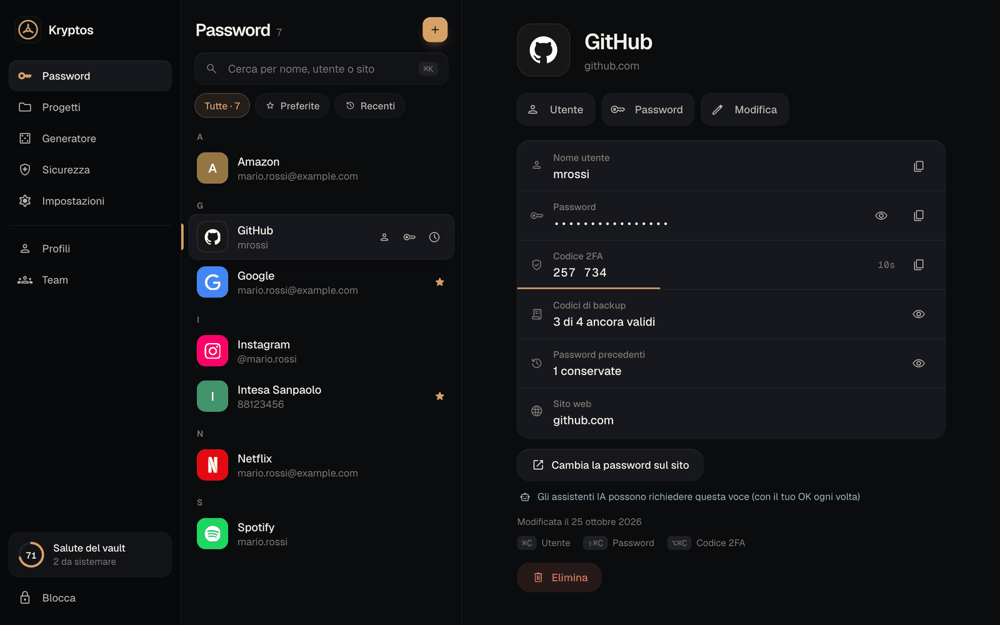</picture>
</p>

> [!WARNING]
> **Versione 0.1: software sperimentale.** Il codice non ha avuto una revisione di sicurezza indipendente e
> alcuni flussi sono stati provati solo in ambienti di test. Non usarlo come **unica** copia di password
> importanti. Le vulnerabilità vanno segnalate in privato: vedi [SECURITY.md](SECURITY.md).

**Piattaforme:** macOS e Android. Windows e Linux non sono ancora provati né
supportati (per esempio, Touch ID esiste solo su macOS). iOS arriverà più avanti.

**Crittografia:** Argon2id (256 MiB su desktop, 64 MiB su mobile) e XChaCha20-Poly1305, con una vault key
casuale cifrata dalla master password. Algoritmi pubblici e standard: la sicurezza dipende dalla tua
master password, non dalla segretezza del codice. Dettagli e modello di minaccia in
[docs/ARCHITECTURE.it.md](docs/ARCHITECTURE.it.md).

## Cosa fa

- **Password e 2FA nello stesso vault:** codici a 6 cifre, codici di backup, cronologia delle password,
  cestino, preferiti, ricerca da tastiera.
- **Una conferma per ogni compilazione:** Touch ID, password del Mac o master password sul computer,
  impronta su Android.
- **Estensione del browser** per Chrome, Arc, Brave, Edge e Firefox, con tendina sotto i campi di accesso,
  avviso sulle pagine che imitano un sito salvato e lettura dei QR della 2FA.
- **Autofill su Android** in tutte le app e i browser. L'app non ha il permesso di accedere a internet.
- **Progetti e `.env`:** file `.env` nel vault, divisi per progetto e ambiente, con versioni e confronto.
- **Riga di comando `kryptos env`:** avvia un comando con le variabili senza lasciare un `.env` su disco.
- **Profili:** vault separati sullo stesso dispositivo, ognuno con la sua master password.
- **Team:** password condivisa su una cartella cloud, oppure **inviti personali (Beta)**.
- **Assistenti IA (MCP):** spenti di default, vedono solo le voci che scegli, con il tuo OK ogni volta.
- **Sincronizzazione senza un server nostro:** cartella del tuo cloud, file di backup o codici QR.
- **Analisi della sicurezza**, generatore, pulizia dei doppioni, importazione da altri strumenti, 9 lingue.

## Screenshot

<table>
  <tr><td width="50%"><picture><source media="(prefers-color-scheme: light)" srcset="docs/assets/screenshots/it/desktop-light/projects.png">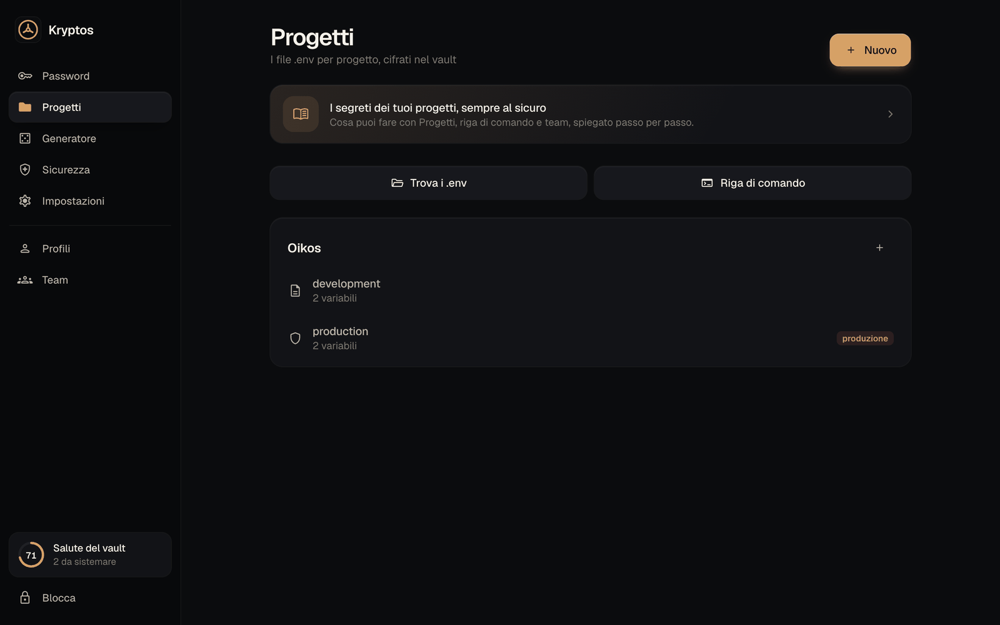</picture></td><td width="50%"><picture><source media="(prefers-color-scheme: light)" srcset="docs/assets/screenshots/it/desktop-light/cli.png">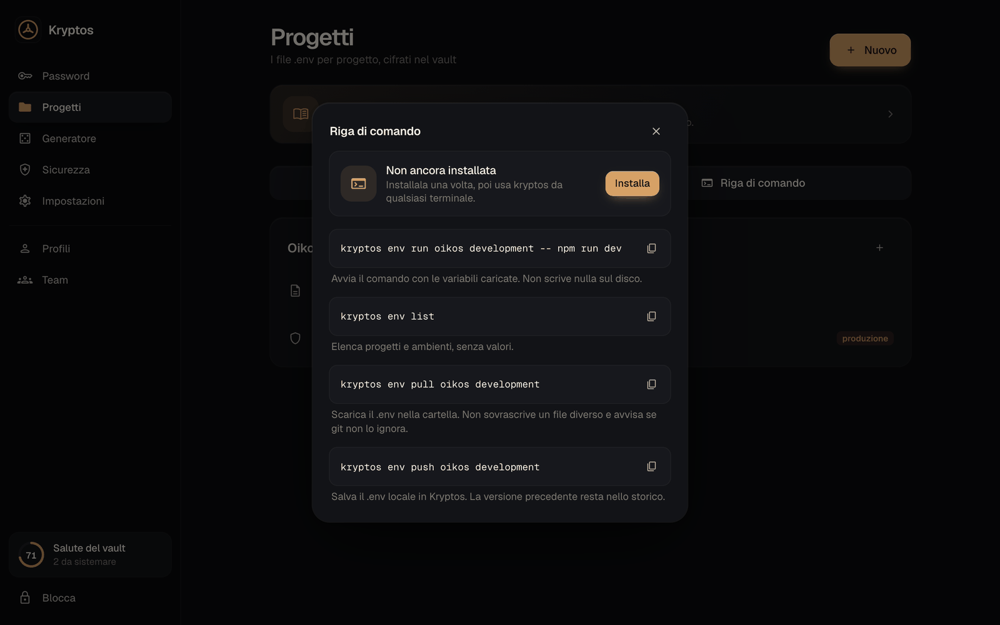</picture></td></tr>
  <tr><td align="center">Progetti: i file .env divisi per ambiente</td><td align="center">Riga di comando: env run, list, pull, push</td></tr>
  <tr><td width="50%"><picture><source media="(prefers-color-scheme: light)" srcset="docs/assets/screenshots/it/desktop-light/guide-terminal.png">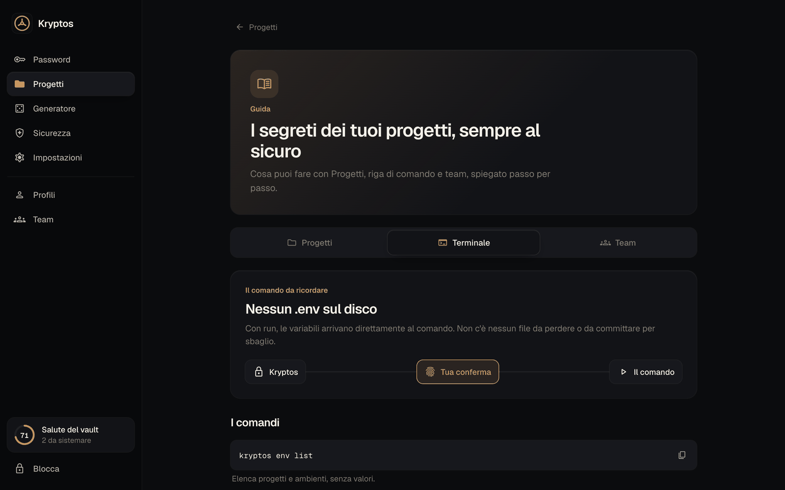</picture></td><td width="50%"><picture><source media="(prefers-color-scheme: light)" srcset="docs/assets/screenshots/it/desktop-light/fill-confirm.png">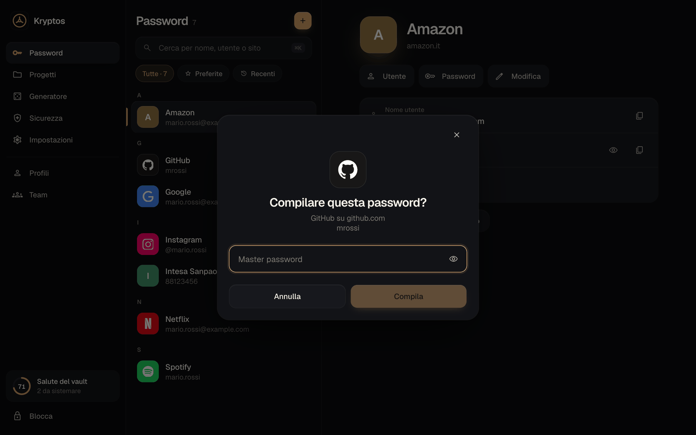</picture></td></tr>
  <tr><td align="center">Guida: il terminale spiegato passo per passo</td><td align="center">Una conferma per ogni compilazione</td></tr>
  <tr><td width="50%"><picture><source media="(prefers-color-scheme: light)" srcset="docs/assets/screenshots/it/desktop-light/security.png">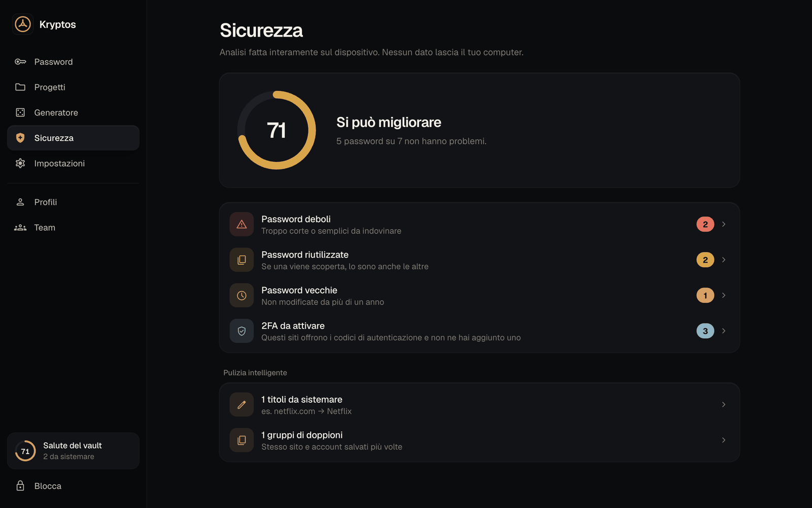</picture></td><td width="50%"><picture><source media="(prefers-color-scheme: light)" srcset="docs/assets/screenshots/it/desktop-light/generator.png">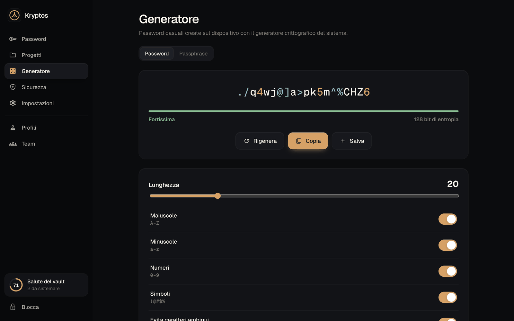</picture></td></tr>
  <tr><td align="center">Analisi della sicurezza, tutta offline</td><td align="center">Generatore di password e passphrase</td></tr>
  <tr><td width="50%"><picture><source media="(prefers-color-scheme: light)" srcset="docs/assets/screenshots/it/desktop-light/settings-sync.png">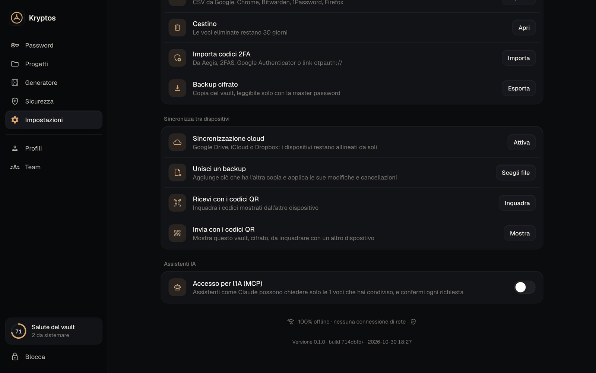</picture></td><td width="50%"><picture><source media="(prefers-color-scheme: light)" srcset="docs/assets/screenshots/it/desktop-light/settings-ai.png">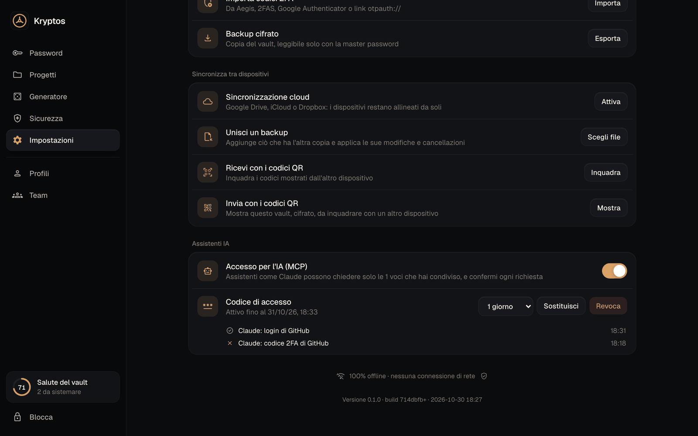</picture></td></tr>
  <tr><td align="center">Sincronizzazione: cloud, backup, QR</td><td align="center">Assistenti IA: accesso, codice e registro</td></tr>
  <tr><td width="50%"><picture><source media="(prefers-color-scheme: light)" srcset="docs/assets/screenshots/it/desktop-light/profiles.png">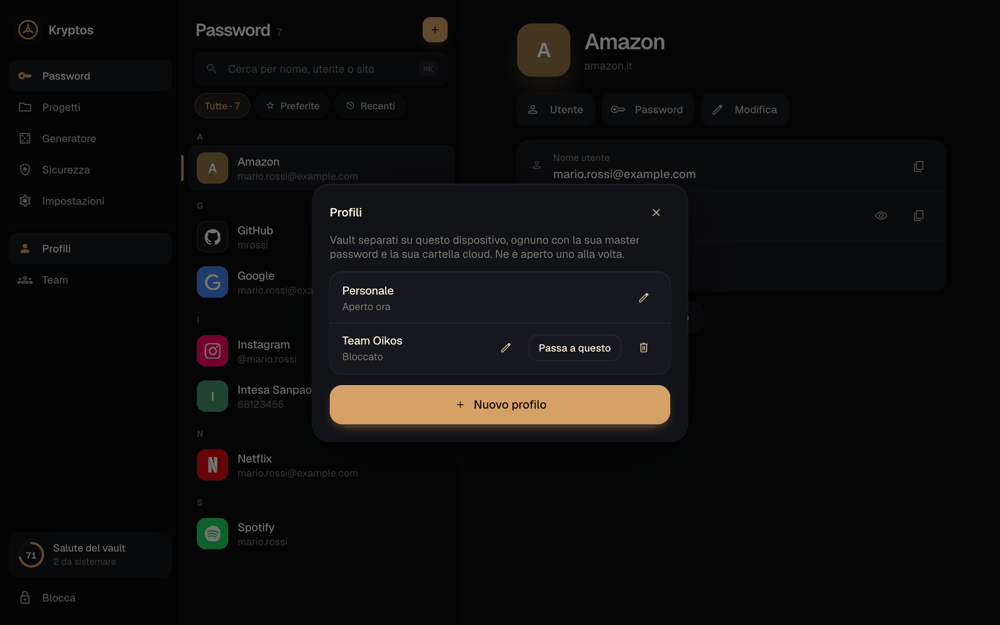</picture></td><td width="50%"><picture><source media="(prefers-color-scheme: light)" srcset="docs/assets/screenshots/it/desktop-light/team.png">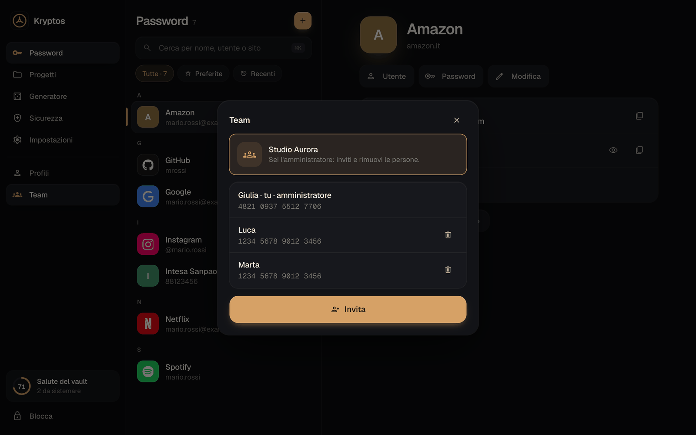</picture></td></tr>
  <tr><td align="center">Profili: vault separati</td><td align="center">Team con inviti personali (Beta)</td></tr>
</table>

**Sul telefono**

<p align="center">
  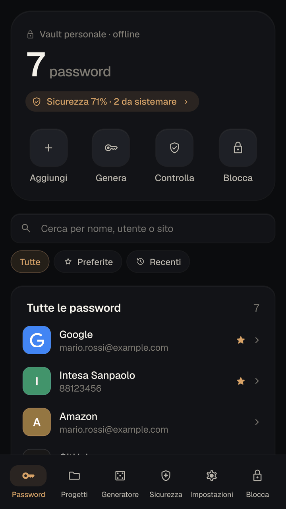
  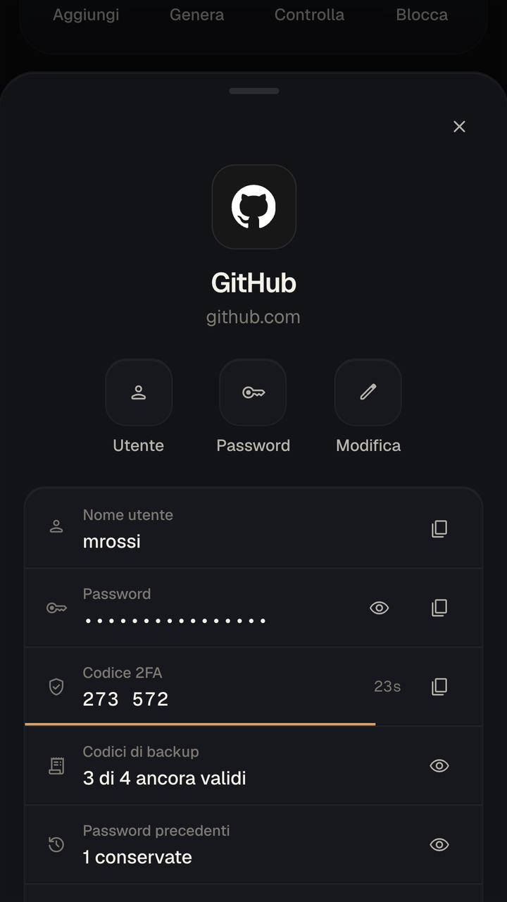
  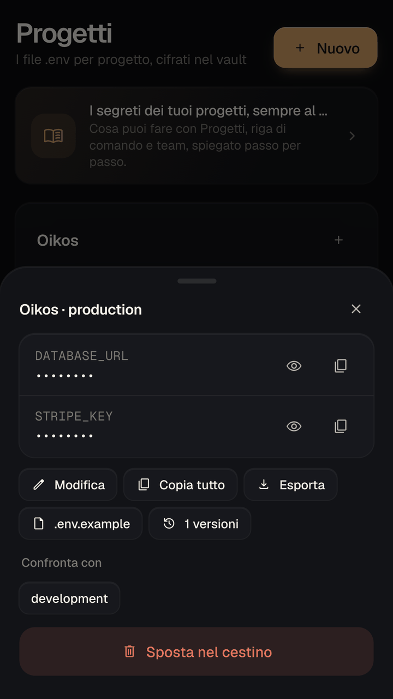
  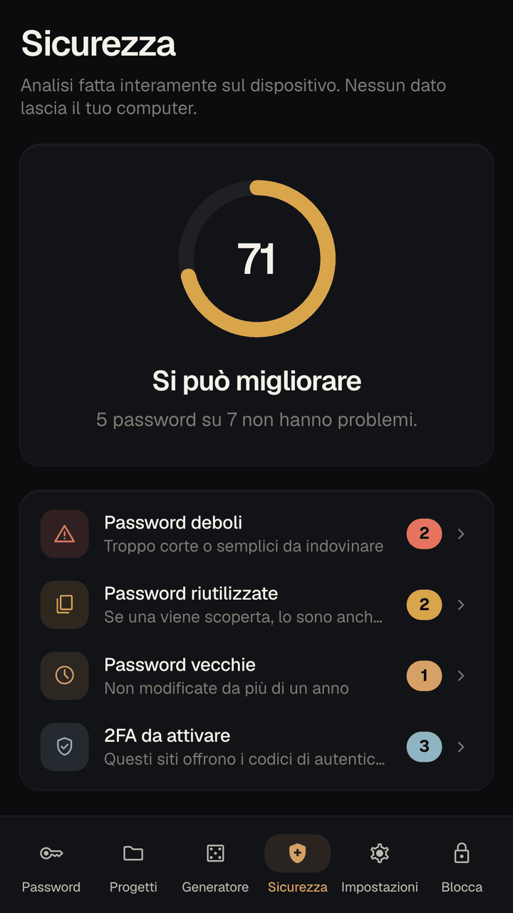
</p>

**Nel browser**

<p align="center">
  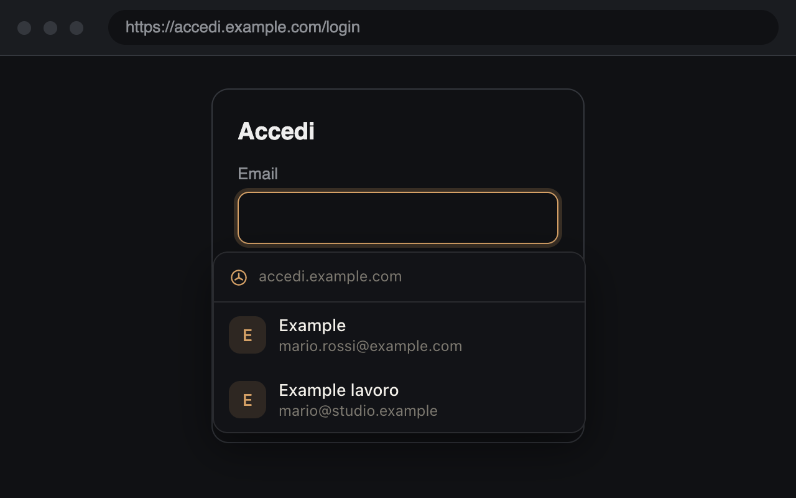
  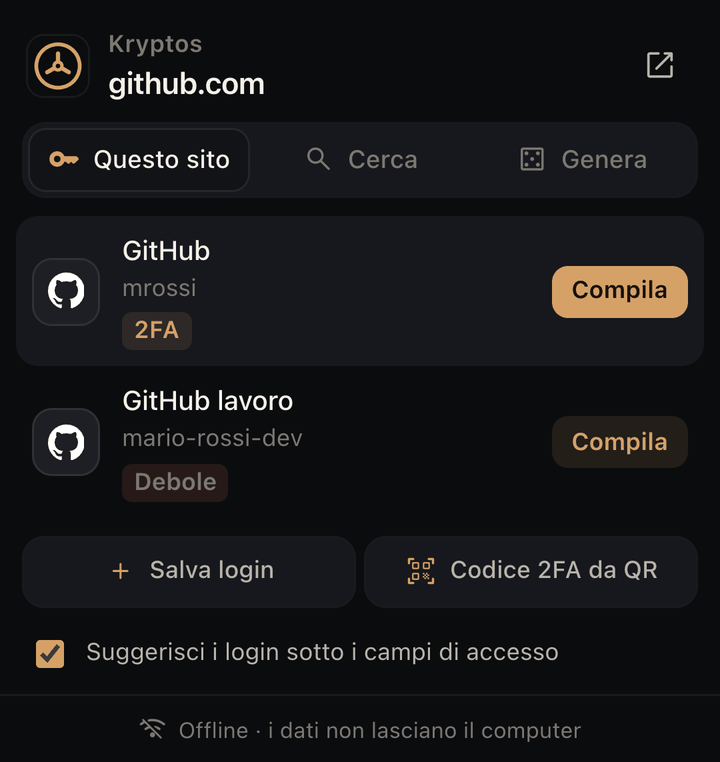
  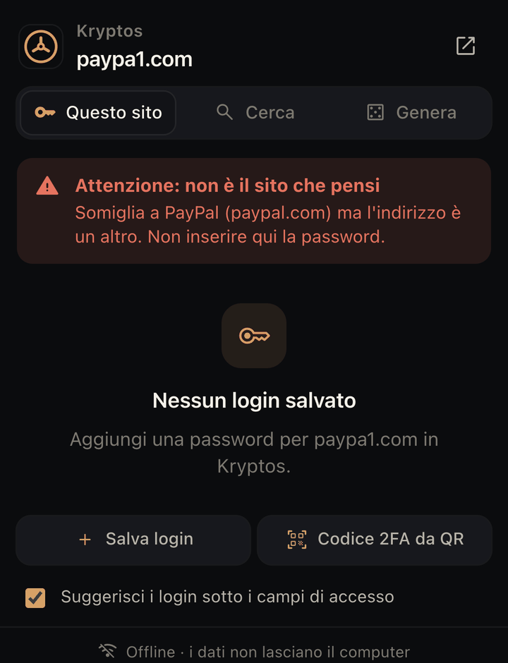
</p>

> Tutti gli screenshot usano dati di esempio. Le altre schermate, anche in tema chiaro, sono in
> [docs/assets/screenshots](docs/assets/screenshots).

## Struttura

```
crates/core                 Rust: crittografia, vault, generatore, matching URL, import, analisi sicurezza
crates/native-host          Relay Native Messaging (browser ⇄ app), incluso nell'app come sidecar
crates/cli                  Riga di comando `kryptos`: parla con l'app, non legge mai il vault
crates/mcp-server           Server MCP per gli assistenti IA
apps/desktop                App Tauri 2 condivisa desktop + mobile
  src/                      UI React (unica per tutte le piattaforme)
  src-tauri/src/            Comandi Rust, bridge browser (desktop), JNI autofill (Android)
  src-tauri/gen/android/    Progetto Android: AutofillService in Kotlin
extension/                  Estensione browser MV3 (Chrome, Arc, Brave, Edge, Firefox)
docs/sito/                  Sito del progetto
docs/store/                 Testi e immagini per gli store
```

## Sviluppo

Requisiti: Rust (rustup), Node 20+. Per Android: Android Studio (SDK + NDK).

```bash
cd apps/desktop && npm install && npm run tauri dev
```

**Anteprima di design nel browser** (dati finti, niente Rust): `npm run dev`, poi apri
http://127.0.0.1:1420. La master password è `password`.

Test del core:

```bash
cargo test -p kryptos-core
```

### Build

```bash
cd apps/desktop && npx tauri build            # macOS .app / .dmg (include il native host)
```

```bash
cd apps/desktop && npx tauri android build --apk --target aarch64
```

Per Android servono `ANDROID_HOME`, `NDK_HOME` e `JAVA_HOME`. Il JDK incluso in Android Studio va bene:
`/Applications/Android Studio.app/Contents/jbr/Contents/Home`.

**Firma delle release Android.** La chiave si crea una volta sola, fuori dal repository (keytool chiede le password):

```bash
keytool -genkeypair -v -keystore ~/kryptos-release.jks -alias kryptos -keyalg RSA -keysize 4096 -validity 10000
```

Poi crea `apps/desktop/src-tauri/gen/android/keystore.properties` (escluso da git) con `storeFile` (percorso
assoluto del `.jks`), `storePassword`, `keyAlias` e `keyPassword`. La CI può indicare un altro file con
`KRYPTOS_KEYSTORE_PROPERTIES`. Tieni un backup del `.jks` e delle password: gli aggiornamenti vanno firmati con
la stessa chiave. Senza il file, le build di release escono non firmate.

## Cambiare il logo

```bash
cd apps/desktop && python3 brand/make-icons.py /percorso/nuovo-logo.png && npx tauri icon icon.png -o src-tauri/icons && python3 brand/make-icons.py --android-only
```

## Estensione browser

1. `chrome://extensions` → Modalità sviluppatore → *Carica estensione non pacchettizzata* → `extension/`
   (l'ID è fisso: `jclbckdbmecjgoopnpchbijihdfeajkb`)
2. Nell'app: **Impostazioni → Estensione browser → Collega**, poi riavvia il browser
3. Su una pagina di login: clic sull'icona Kryptos, oppure ⌘⇧L
4. Scegli il login e conferma in Kryptos: Touch ID o la password del Mac, oppure la master password se
   preferisci (**Impostazioni → Browser → Conferma ogni compilazione**). Lo chiede a ogni singola
   compilazione, quindi l'unica password che digiti è la master password, o nessuna.
5. Nuovo account o password cambiata? Scrivila nel modulo, apri il popup e premi **Salva login**, oppure
   usa la scheda **Genera** per crearne una e metterla nel modulo.
6. Stai attivando la verifica in due passaggi? Con il QR del sito sullo schermo, premi **Codice 2FA da QR**
   nel popup e scegli la voce in Kryptos.
7. Clic su un campo di accesso: sotto il campo compare la tendina con i login del sito. Sulle pagine gira solo
   un piccolo script che nota quel clic; non legge cosa scrivi, la tendina è isolata dal sito e si spegne dal
   popup (*Suggerisci i login sotto i campi di accesso*).
8. Inoltre: **Cerca** in tutto il vault, ⌥⇧L per compilare l'ultimo login usato sul sito, tasto destro su
   un campo per *Compila con Kryptos* o *Genera una password sicura qui*. Se una pagina imita un sito che
   hai salvato, il popup ti avvisa in rosso.

La chiave privata dell'estensione (`secrets/extension-key.pem`) serve solo per pacchettizzare un `.crx`.
Non va condivisa ed è esclusa da git.

## Autofill su Android

Impostazioni Android → Password e account → Servizio di compilazione automatica → **Kryptos**.
Oppure, via adb:

```bash
adb shell settings put secure autofill_service com.kryptos.vault/.KryptosAutofillService
```

Con lo sblocco a impronta attivo (**Impostazioni → Sblocco con impronta**), ogni suggerimento chiede
l'impronta prima di compilare.

Quando accedi o ti registri con una password che Kryptos non conosce ancora, Android propone di salvarla
in Kryptos (o di aggiornare la password di quell'account).

## Codici 2FA

Kryptos può tenere anche il codice della verifica in due passaggi di un sito. Quando il sito mostra il QR,
premi **Codice 2FA da QR** nel popup dell'estensione, oppure sul telefono inquadralo con la fotocamera. In
alternativa copia la chiave e incollala nel campo **Codice 2FA** della voce (va bene anche un link
`otpauth://`). La voce mostra poi il codice a 6 cifre del momento, pronto da copiare.
Lì puoi incollare anche i **codici di backup** del sito, uno per riga, oppure premere **Da file** e scegliere
il file che il sito ti ha fatto scaricare: li copi uno alla volta e segni quelli usati.

Sulla pagina che chiede il codice, Kryptos lo compila: su Android con il solito suggerimento, sul computer
scegliendo il login nell'estensione (username, password e codice insieme). I codici che tieni già in un'app
di autenticazione si portano con **Impostazioni → Importa codici 2FA**: un'esportazione non cifrata di Aegis
o 2FAS, un link di trasferimento di Google Authenticator o un elenco di link `otpauth://`. Ogni codice si
aggiunge al login dello stesso servizio, o diventa una voce nuova. Poi elimina il file esportato.
Tenere password e codice nello stesso vault è comodo, ma per gli account più importanti (email, banca)
un'app di autenticazione separata è più sicura.

## Progetti e `.env`

**Progetti** tiene i file `.env` nel vault, cifrati come le password e divisi per progetto e ambiente. Puoi
importare un file, incollare il testo o, sul computer, cercare tutti i `.env` in una cartella. Ogni ambiente
conserva le ultime versioni, si confronta con un altro senza mostrare i valori e genera un `.env.example`
pronto per git. Gli ambienti di produzione non si condividono mai con gli assistenti IA.

### Riga di comando

Sul computer: **Progetti → Riga di comando → Installa**. Kryptos deve essere aperto e sbloccato, e ogni
lettura o scrittura chiede conferma nella finestra dell'app.

```bash
kryptos env list
kryptos env run oikos development -- npm run dev
kryptos env pull oikos development
kryptos env push oikos development
kryptos env example
```

`run` avvia il comando con le variabili e non scrive nulla su disco: è il modo consigliato. La guida nella
schermata Progetti spiega tutto passo per passo.

## Profili e team

**Profili** sono vault separati sullo stesso dispositivo, ognuno con la sua master password e la sua cartella
cloud. Se ne apre uno alla volta: estensione, assistenti IA e riga di comando vedono solo quello aperto.

Per lavorare in gruppo ci sono due strade:

- **Password del team.** Un profilo condiviso su una cartella cloud, con la stessa password per tutti. È
  semplice, ma quando qualcuno se ne va bisogna cambiare la password e i segreti che ha visto.
- **Inviti personali (Beta).** Ognuno ha la propria chiave, generata sul suo dispositivo. La persona ti manda
  il suo codice pubblico, confrontate a voce il codice di sicurezza e tu approvi. Quando se ne va, la chiave
  del team cambia e non legge gli aggiornamenti successivi. Quello che ha già visto, però, lo conosce: cambia
  le chiavi API e le password interessate.

## Assistenti IA (MCP)

Kryptos può far usare a un assistente IA (Claude Desktop, Claude Code, qualsiasi client MCP) **solo i login
che scegli tu**, ogni volta con il tuo OK:

1. In una voce attiva **Disponibile per gli assistenti IA**.
2. **Impostazioni → Assistenti IA**: attiva l'accesso, scegli quanto dura il codice e premi **Crea**. Copia
   la configurazione mostrata e incollala nelle impostazioni MCP della tua app IA.
3. Quando l'assistente ha bisogno di quel login, Kryptos viene in primo piano e chiede Touch ID o la master
   password. Senza non dà nulla; le richieste recenti sono elencate nelle Impostazioni.

Una password data a un assistente esce da Kryptos e arriva al fornitore dell'IA: condividi account di
lavoro o di test, non la banca o l'email principale. Revoca il codice quando hai finito.

## Spostare le password tra dispositivi

Kryptos non ha un server, quindi i dispositivi non si parlano mai via rete. Per portare le password dal
telefono al computer (o viceversa) si sposta una **copia del vault cifrato** e la si unisce:
**Impostazioni → Sincronizza tra dispositivi**.

- **Con un file.** Sul dispositivo che ha le password: *Backup cifrato → Esporta* (su Android anche
  *Condividi*, per mandarlo con Quick Share, Drive, una chat con te stesso…). Sull'altro: *Unisci un
  backup → Scegli file*.
- **Con i codici QR, senza nessun file.** Su un dispositivo: *Invia con i codici QR → Mostra*: il vault
  cifrato compare come una breve sequenza di QR. Sull'altro: *Ricevi con i codici QR → Inquadra*, e punta
  la fotocamera sullo schermo finché la barra non è piena. Comodo dal computer al telefono (per il verso
  opposto serve una fotocamera sul computer).

In entrambi i casi poi inserisci la **master password della copia ricevuta** (di solito è la stessa) e
Kryptos unisce voce per voce: aggiunge quello che ha solo l'altra copia, per le modifiche vince la più
recente e riporta anche le cancellazioni. Niente viene mai sostituito in blocco.

Quello che viaggia è il vault cifrato, esattamente come un backup: chi intercetta il file, o filma i QR,
ha comunque bisogno della master password. Detto questo, non lasciare backup in giro in cartelle condivise.

**In automatico, tramite il tuo cloud.** *Impostazioni → Sincronizza tra dispositivi → Sincronizzazione
cloud → Attiva*: sul Mac scegli Google Drive, iCloud Drive, Dropbox o OneDrive dall'elenco, su Android tocca *Scegli la
cartella cloud* e selezionala (una volta sola). Poi inserisci la master password, che deve essere fortissima. Kryptos tiene lì una copia cifrata in una cartella `Kryptos` e da
quel momento allinea da solo tutti i dispositivi. Kryptos continua a non collegarsi a internet: il file
lo sposta l'app del cloud. Su un secondo dispositivo che ha già le sue password, inserisci una volta la
master password dell'altro: le sue voci vengono unite e da lì entrambi usano lo stesso vault e la stessa
password (su Android, dopo, riattiva lo sblocco con impronta).

## Loghi dei siti

Le voci mostrano il logo del sito quando è disponibile. I loghi provengono da
[Simple Icons](https://simpleicons.org) (CC0) e sono inclusi nell'app al momento della build: **nessuna
richiesta di rete viene mai fatta per scaricare un'icona**, quindi nessuno può sapere su quali siti hai
un account. I siti senza logo mantengono l'iniziale colorata. Marchi e loghi appartengono ai rispettivi
proprietari e sono usati solo per identificare i siti.

## Licenza

[GPL-3.0-or-later](LICENSE). Puoi usare, studiare, modificare e ridistribuire Kryptos. Le versioni
modificate che distribuisci devono restare open source con la stessa licenza.
