<p align="center">
  
</p>

<p align="center">
  English · <a href="README.it.md">Italiano</a>
</p>

<h1 align="center">Kryptos</h1>

<p align="center">
  <b>Offline password manager</b> for macOS and Android, with a browser extension.<br>
  No servers, no accounts: your encrypted vault stays on your devices.
</p>

<p align="center">
  <a href="LICENSE"></a>
  
  
  
</p>

<p align="center">
  <picture><source media="(prefers-color-scheme: light)" srcset="docs/assets/screenshots/en/desktop-light/entry.png">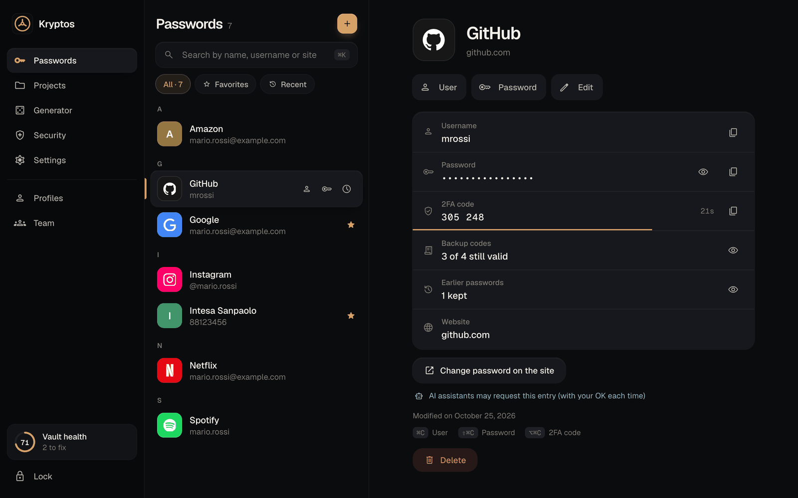</picture>
</p>

> [!WARNING]
> **Version 0.1: experimental software.** The code has not had an independent security review and some
> flows have only been tried in test environments. Don't use it as the **only** copy of important
> passwords. Please report vulnerabilities privately: see [SECURITY.md](SECURITY.md).

**Platforms:** macOS and Android. Windows and Linux are not tested or supported yet (Touch
ID, for example, exists only on macOS). iOS will come later.

**Cryptography:** Argon2id (256 MiB on desktop, 64 MiB on mobile) and XChaCha20-Poly1305, with a random
vault key encrypted by the master password. Public, standard algorithms: security depends on your master
password, not on keeping the code secret. Details and threat model in
[docs/ARCHITECTURE.md](docs/ARCHITECTURE.md).

## What it does

- **Passwords and 2FA in one vault:** 6-digit codes, backup codes, password history, trash, favorites,
  keyboard search.
- **One confirmation for every fill:** Touch ID, Mac password or master password on the computer,
  fingerprint on Android.
- **Browser extension** for Chrome, Arc, Brave, Edge and Firefox, with a list under login fields, a warning
  on pages that imitate a saved site, and 2FA QR reading.
- **Android autofill** in all apps and browsers. The app has no internet permission.
- **Projects and `.env`:** `.env` files in the vault, split by project and environment, with versions and
  comparison.
- **`kryptos env` command line:** run a command with the variables and leave no `.env` on disk.
- **Profiles:** separate vaults on one device, each with its own master password.
- **Teams:** a shared password on a cloud folder, or **personal invitations (Beta)**.
- **AI assistants (MCP):** off by default, they see only the entries you choose, with your OK every time.
- **Sync without a server of ours:** your cloud folder, a backup file or QR codes.
- **Security analysis**, generator, duplicate cleanup, import from other tools, 9 languages.

## Screenshots

<table>
  <tr><td width="50%"><picture><source media="(prefers-color-scheme: light)" srcset="docs/assets/screenshots/en/desktop-light/projects.png">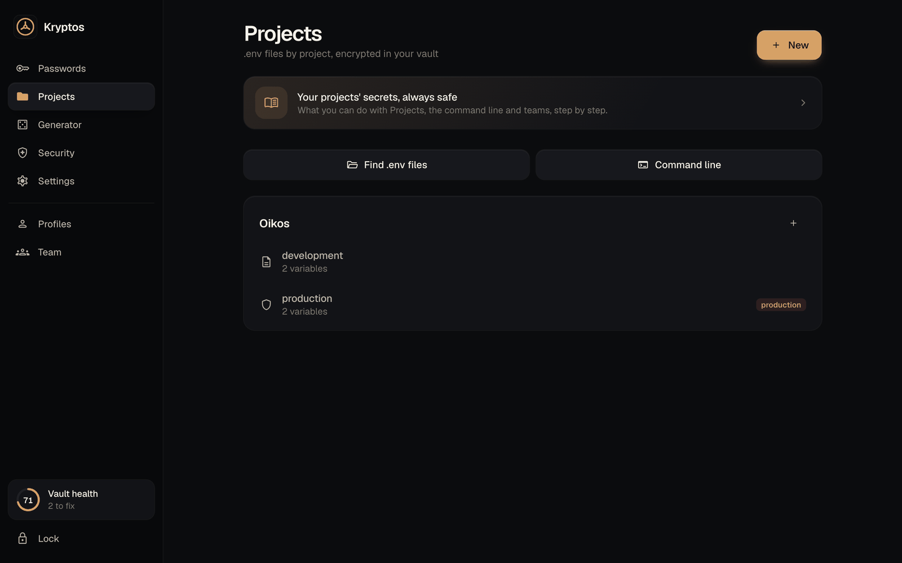</picture></td><td width="50%"><picture><source media="(prefers-color-scheme: light)" srcset="docs/assets/screenshots/en/desktop-light/cli.png">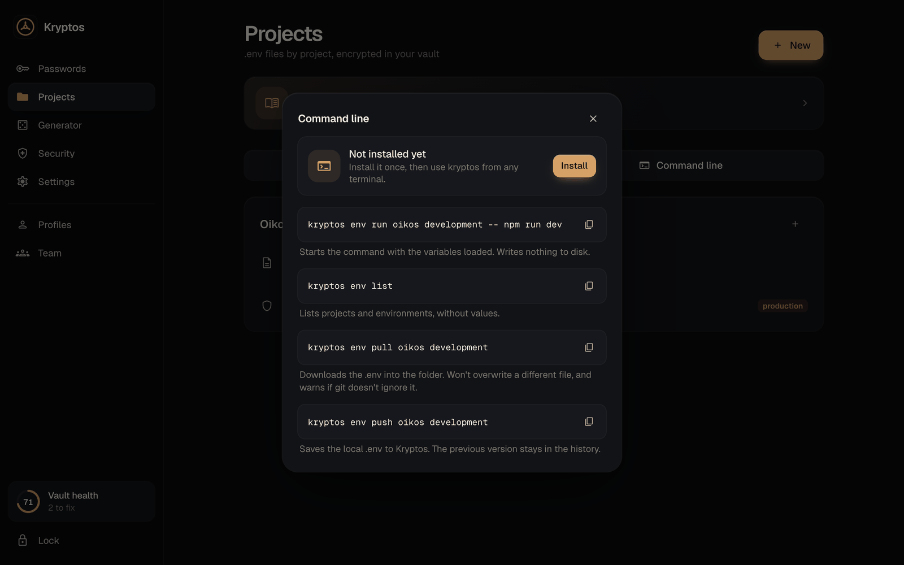</picture></td></tr>
  <tr><td align="center">Projects: .env files split by environment</td><td align="center">Command line: env run, list, pull, push</td></tr>
  <tr><td width="50%"><picture><source media="(prefers-color-scheme: light)" srcset="docs/assets/screenshots/en/desktop-light/guide-terminal.png">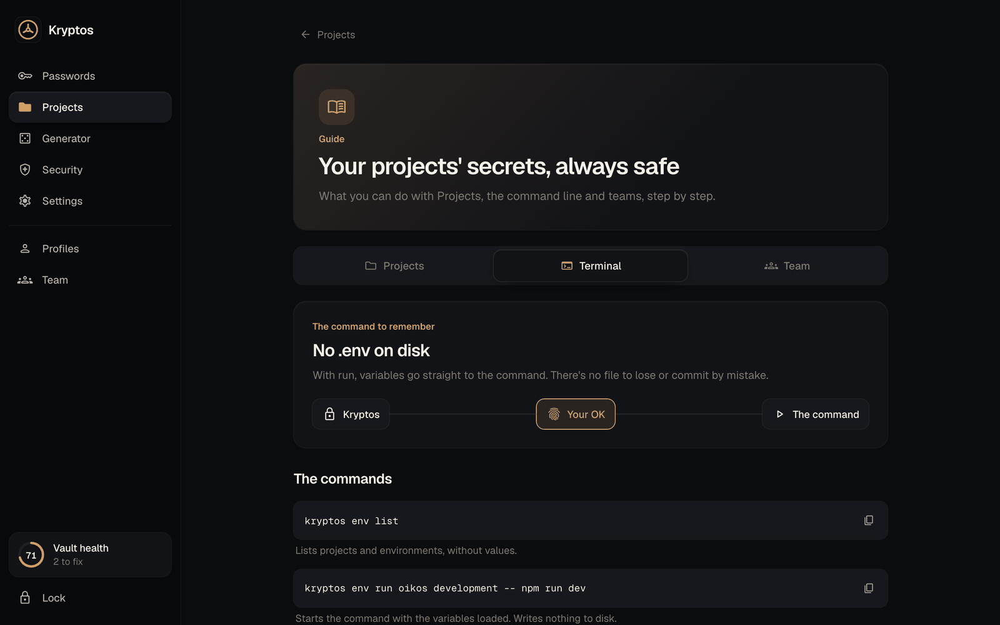</picture></td><td width="50%"><picture><source media="(prefers-color-scheme: light)" srcset="docs/assets/screenshots/en/desktop-light/fill-confirm.png">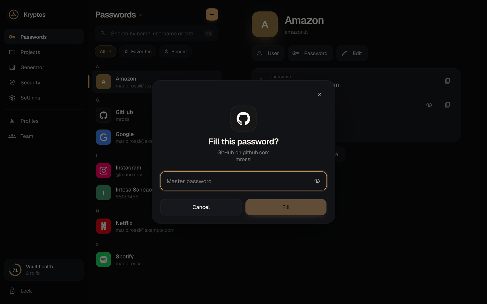</picture></td></tr>
  <tr><td align="center">Guide: the terminal explained step by step</td><td align="center">One confirmation for every fill</td></tr>
  <tr><td width="50%"><picture><source media="(prefers-color-scheme: light)" srcset="docs/assets/screenshots/en/desktop-light/security.png">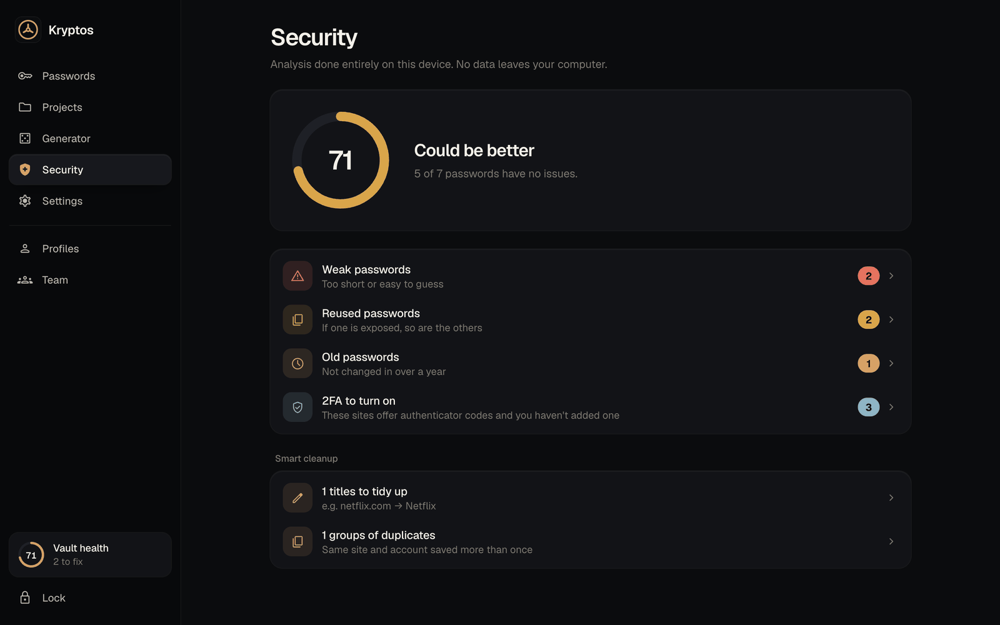</picture></td><td width="50%"><picture><source media="(prefers-color-scheme: light)" srcset="docs/assets/screenshots/en/desktop-light/generator.png">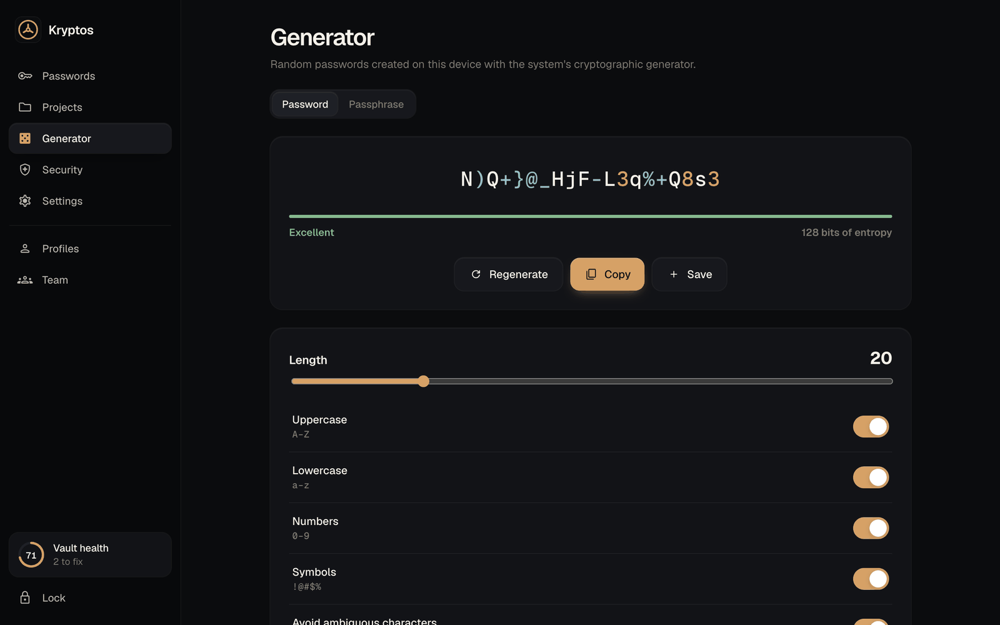</picture></td></tr>
  <tr><td align="center">Security analysis, entirely offline</td><td align="center">Password and passphrase generator</td></tr>
  <tr><td width="50%"><picture><source media="(prefers-color-scheme: light)" srcset="docs/assets/screenshots/en/desktop-light/settings-sync.png">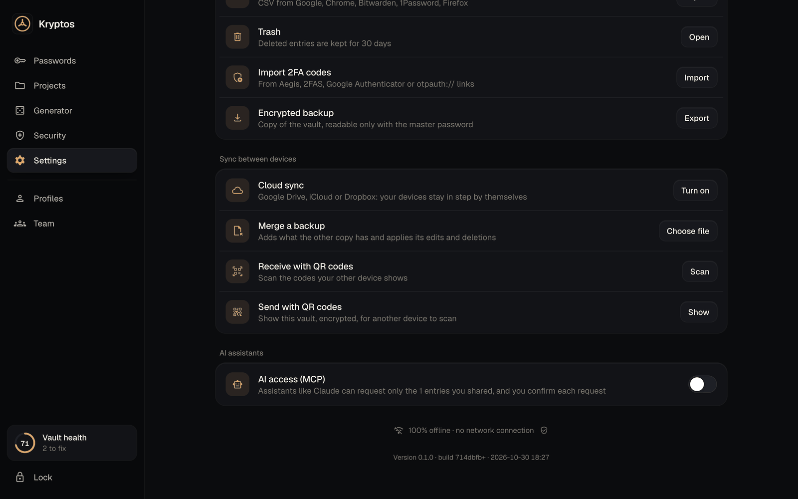</picture></td><td width="50%"><picture><source media="(prefers-color-scheme: light)" srcset="docs/assets/screenshots/en/desktop-light/settings-ai.png">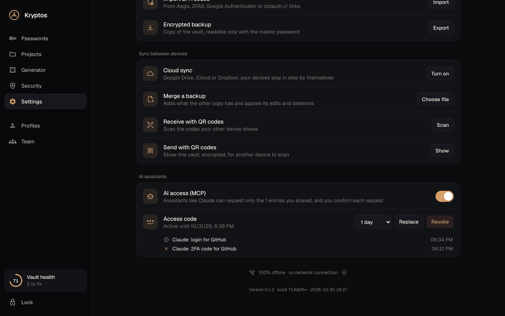</picture></td></tr>
  <tr><td align="center">Sync: cloud, backup, QR</td><td align="center">AI assistants: access, code and log</td></tr>
  <tr><td width="50%"><picture><source media="(prefers-color-scheme: light)" srcset="docs/assets/screenshots/en/desktop-light/profiles.png">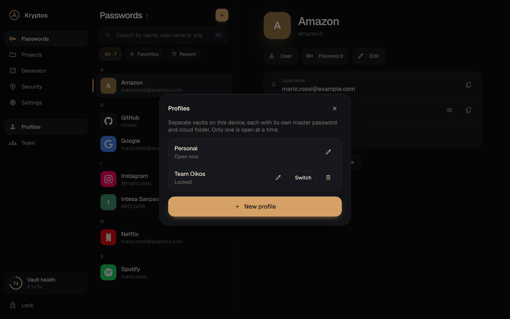</picture></td><td width="50%"><picture><source media="(prefers-color-scheme: light)" srcset="docs/assets/screenshots/en/desktop-light/team.png">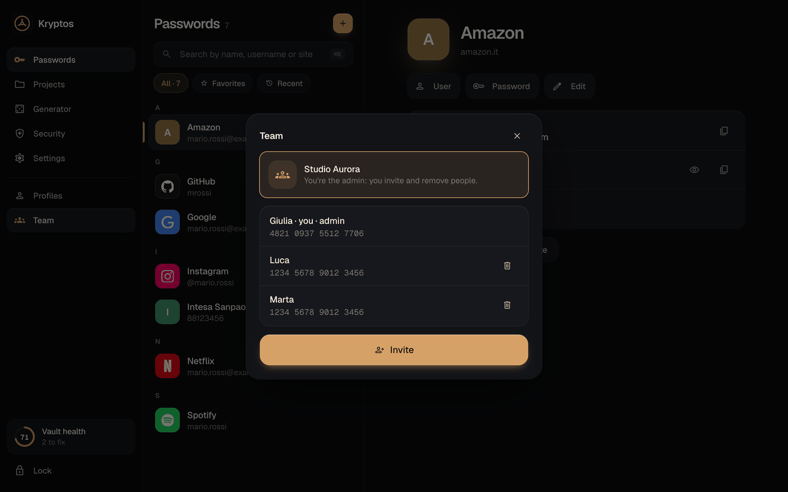</picture></td></tr>
  <tr><td align="center">Profiles: separate vaults</td><td align="center">Team with personal invitations (Beta)</td></tr>
</table>

**On the phone**

<p align="center">
  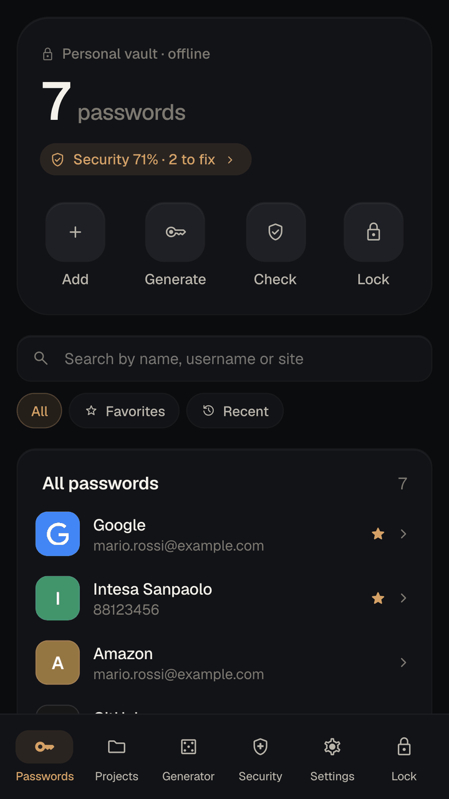
  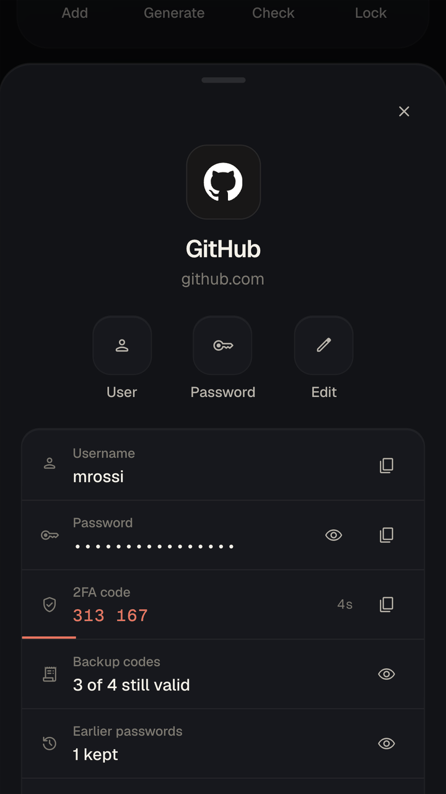
  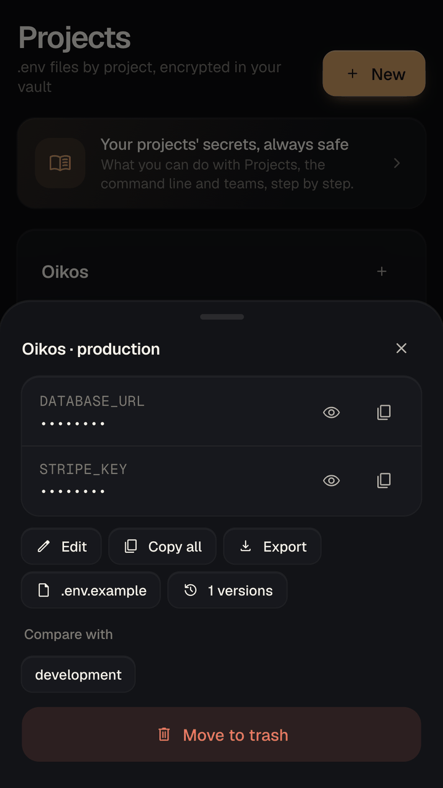
  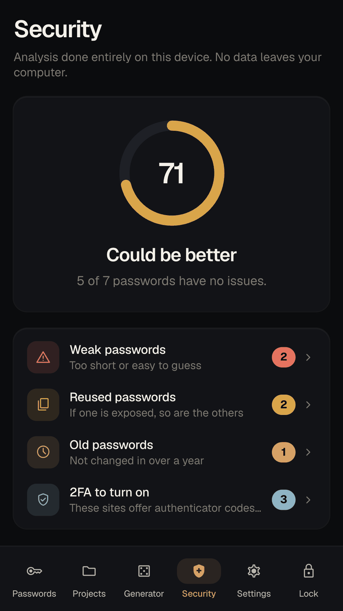
</p>

**In the browser**

<p align="center">
  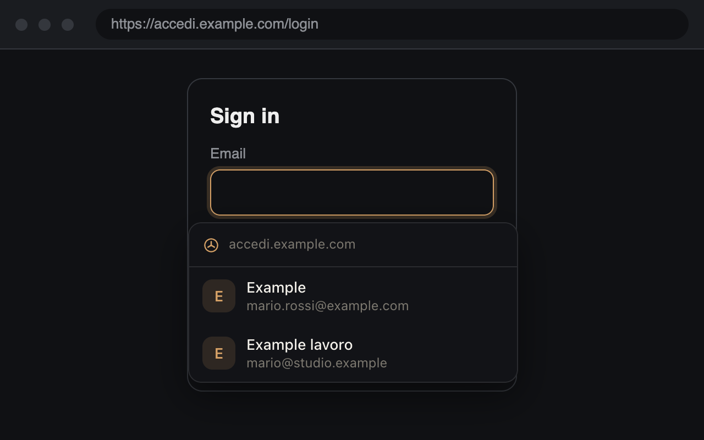
  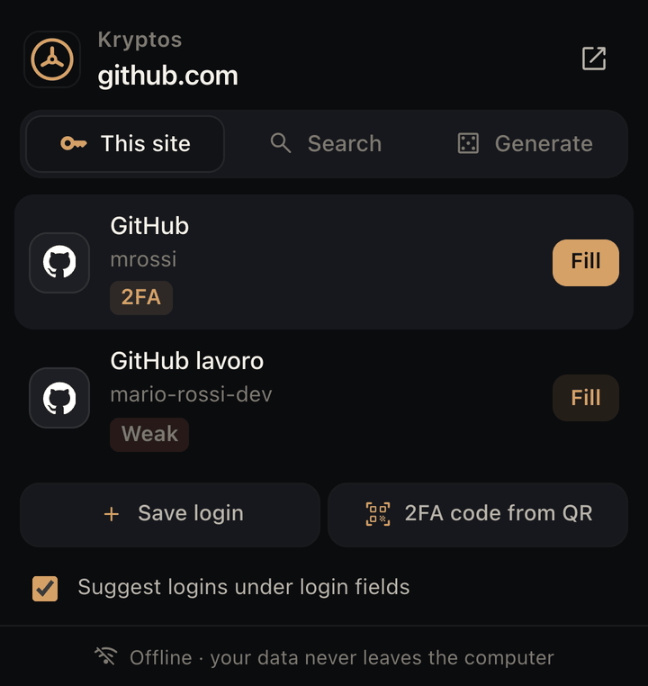
  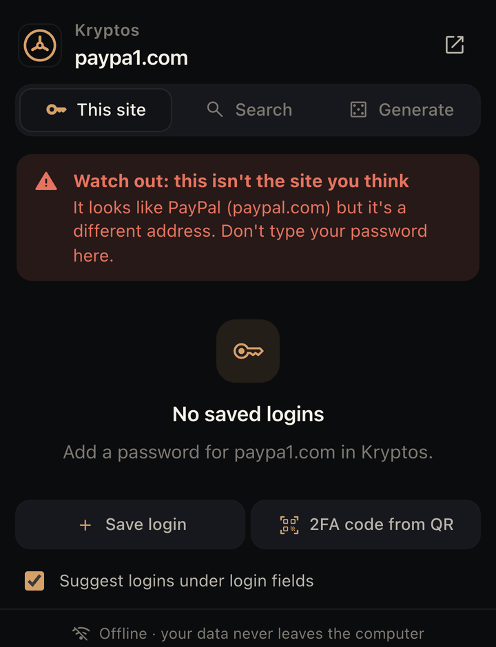
</p>

> All screenshots use sample data. More screens, including the light theme, are in
> [docs/assets/screenshots](docs/assets/screenshots).

## Layout

```
crates/core                 Rust: crypto, vault, generator, URL matching, import, security analysis
crates/native-host          Native Messaging relay (browser ⇄ app), bundled in the app as a sidecar
crates/cli                  `kryptos` command line: talks to the app, never reads the vault
crates/mcp-server           MCP server for AI assistants
apps/desktop                Tauri 2 app shared by desktop and mobile
  src/                      React UI (one for all platforms)
  src-tauri/src/            Rust commands, browser bridge (desktop), autofill JNI (Android)
  src-tauri/gen/android/    Android project: Kotlin AutofillService
extension/                  MV3 browser extension (Chrome, Arc, Brave, Edge, Firefox)
docs/sito/                  Project website
docs/store/                 Store texts and images
```

## Development

Requirements: Rust (rustup), Node 20+. For Android: Android Studio (SDK + NDK).

```bash
cd apps/desktop && npm install && npm run tauri dev
```

**Design preview in the browser** (fake data, no Rust): `npm run dev`, then open
http://127.0.0.1:1420. The master password is `password`.

Core tests:

```bash
cargo test -p kryptos-core
```

### Build

```bash
cd apps/desktop && npx tauri build            # macOS .app / .dmg (includes the native host)
```

```bash
cd apps/desktop && npx tauri android build --apk --target aarch64
```

Android needs `ANDROID_HOME`, `NDK_HOME` and `JAVA_HOME`. The JDK bundled with Android Studio works:
`/Applications/Android Studio.app/Contents/jbr/Contents/Home`.

**Signing Android releases.** Create the key once, outside the repository (keytool asks for the passwords):

```bash
keytool -genkeypair -v -keystore ~/kryptos-release.jks -alias kryptos -keyalg RSA -keysize 4096 -validity 10000
```

Then create `apps/desktop/src-tauri/gen/android/keystore.properties` (git-ignored) with `storeFile` (absolute
path to the `.jks`), `storePassword`, `keyAlias` and `keyPassword`. CI can point to another file with
`KRYPTOS_KEYSTORE_PROPERTIES`. Keep a backup of the `.jks` and its passwords: updates must be signed with the
same key. Without the file, release builds come out unsigned.

## Changing the logo

```bash
cd apps/desktop && python3 brand/make-icons.py /path/to/new-logo.png && npx tauri icon icon.png -o src-tauri/icons && python3 brand/make-icons.py --android-only
```

## Browser extension

1. `chrome://extensions` → Developer mode → *Load unpacked* → `extension/`
   (the ID is fixed: `jclbckdbmecjgoopnpchbijihdfeajkb`)
2. In the app: **Settings → Browser extension → Connect**, then restart the browser
3. On a login page: click the Kryptos icon, or ⌘⇧L
4. Pick the login and confirm in Kryptos: Touch ID or your Mac password, or the master password if you
   prefer (**Settings → Browser → Confirm each fill**). Every single fill asks, so the only password you
   ever type is the master password, or none at all.
5. New account or changed password? Type it in the form, open the popup and press **Save login**, or use
   the **Generate** tab to create one and put it in the form.
6. Turning on two-step verification? With the site's QR code on screen, press **2FA code from QR** in the
   popup and pick the entry in Kryptos.
7. Click a login field: the site's logins appear in a list under it. On pages only a small script runs, which
   notices that click; it doesn't read what you type, the list is isolated from the site, and you can turn it
   off from the popup (*Suggest logins under login fields*).
8. Also: **Search** the whole vault, ⌥⇧L to fill the last login used on the site, right-click a field for
   *Fill with Kryptos* or *Generate a strong password here*. If a page imitates a site you saved, the
   popup warns you in red.

The extension's private key (`secrets/extension-key.pem`) is only needed to package a `.crx`. Don't
share it; it's excluded from git.

## Android autofill

Android Settings → Passwords & accounts → Autofill service → **Kryptos**.
Or, via adb:

```bash
adb shell settings put secure autofill_service com.kryptos.vault/.KryptosAutofillService
```

With fingerprint unlock on (**Settings → Fingerprint unlock**), every suggestion asks for your
fingerprint before filling.

When you log in or sign up with a password Kryptos doesn't know yet, Android offers to save it in
Kryptos (or to update the password of that account).

## 2FA codes

Kryptos can also hold the two-step verification code of a site. When the site shows its QR code, press
**2FA code from QR** in the extension popup, or point the phone's camera at it. You can also copy the key
and paste it in the entry's **2FA code** field (an `otpauth://` link works too). The entry then shows the current 6-digit code, ready to copy. Paste the site's **backup codes**
there as well, one per line, or press **From file** and pick the file the site let you download: you can
copy each one and mark it as used.

On a page that asks for the code, Kryptos fills it: on Android through the usual suggestion, on the
computer by picking the login in the extension (username, password and code go in together). Codes you
already keep in an authenticator app can be brought over with **Settings → Import 2FA codes**: an
unencrypted export from Aegis or 2FAS, a Google Authenticator transfer link, or a list of `otpauth://`
links. Each code joins the login of the same service, or becomes a new entry. Delete the export afterwards. Keeping password and code in the same
vault is convenient, but for your most important accounts (email, bank) a separate authenticator app is
safer.

## Projects and `.env`

**Projects** keeps `.env` files in the vault, encrypted like passwords and split by project and environment.
You can import a file, paste the text or, on the computer, search a folder for every `.env`. Each environment
keeps its recent versions, compares with another without showing values, and generates a `.env.example`
ready for git. Production environments are never shared with AI assistants.

### Command line

On the computer: **Projects → Command line → Install**. Kryptos must be open and unlocked, and each read or
write asks you to confirm in the app window.

```bash
kryptos env list
kryptos env run oikos development -- npm run dev
kryptos env pull oikos development
kryptos env push oikos development
kryptos env example
```

`run` starts the command with the variables and writes nothing to disk: it's the recommended way. The guide
in the Projects screen explains everything step by step.

## Profiles and teams

**Profiles** are separate vaults on one device, each with its own master password and cloud folder. One is
open at a time: the extension, AI assistants and the command line see only that one.

There are two ways to work as a group:

- **Team password.** A profile shared on a cloud folder, with the same password for everyone. It's simple, but
  when someone leaves you must change the password and the secrets they saw.
- **Personal invitations (Beta).** Each person has their own key, generated on their device. They send you
  their public code, you compare the safety code out loud, and you approve. When they leave, the team key
  changes and they can't read later updates. What they already saw, they still know: change the API keys and
  passwords involved.

## AI assistants (MCP)

Kryptos can let an AI assistant (Claude Desktop, Claude Code, any MCP client) use **only the logins you
choose**, each time with your OK:

1. In an entry, turn on **Available to AI assistants**.
2. **Settings → AI assistants**: turn on AI access, pick how long the access code lasts and press
   **Create**. Copy the config shown and paste it into your AI app's MCP settings.
3. When the assistant needs that login, Kryptos comes forward and asks for Touch ID or your master
   password. Nothing is given without it; recent requests are listed in Settings.

A password given to an assistant leaves Kryptos and reaches the AI provider: share work or test
accounts, not your bank or main email. Revoke the code when you're done.

## Moving passwords between devices

Kryptos has no server, so devices never talk to each other over the network. To bring the passwords
from your phone to your computer (or the other way round) you move a **copy of the encrypted vault**
and merge it: **Settings → Sync between devices**.

- **With a file.** On the device that has the passwords: *Encrypted backup → Export* (on Android also
  *Share*, to send it with Quick Share, Drive, a chat with yourself…). On the other device: *Merge a
  backup → Choose file*.
- **With QR codes, no file at all.** On one device: *Send with QR codes → Show*: the encrypted vault is
  shown as a short loop of QR codes. On the other: *Receive with QR codes → Scan*, and point the camera
  at the screen until the bar is full. Useful from computer to phone (the computer needs a camera for the
  other direction).

Either way you then enter the **master password of the copy you received** (usually the same one) and
Kryptos merges entry by entry: what only the other copy has is added, the most recent edit wins, and
deletions are carried over too. Nothing is ever replaced wholesale.

What travels is the encrypted vault, exactly like a backup: whoever intercepts the file, or films the
QR codes, still needs the master password. Even so, don't leave backups lying around in shared folders.

**Automatic, through your cloud.** *Settings → Sync between devices → Cloud sync → Turn on*: on the Mac
pick Google Drive, iCloud Drive, Dropbox or OneDrive from the list, on Android tap *Choose the cloud folder* and pick
one (once). Then enter your master password, which must be very strong. Kryptos
keeps an encrypted copy in a `Kryptos` folder there and from then on keeps every device in step by
itself. Kryptos still never connects to the internet: the cloud app moves the file. On a second device
that already has its own passwords, you enter the other device's master password once: its entries are
merged in and from then on both use the same vault and password (on Android, turn fingerprint unlock on
again afterwards).

## Site logos

Entries show the logo of their website when one is available. Logos come from
[Simple Icons](https://simpleicons.org) (CC0), bundled with the app at build time: **no request is
ever made to fetch an icon**, so nobody can learn which sites you have accounts on. Sites without a
logo keep the coloured initial. All trademarks and logos belong to their respective owners and are used
only to identify the sites.

## License

[GPL-3.0-or-later](LICENSE). You can use, study, modify and redistribute Kryptos. Modified versions you
distribute must stay open source under the same license.
